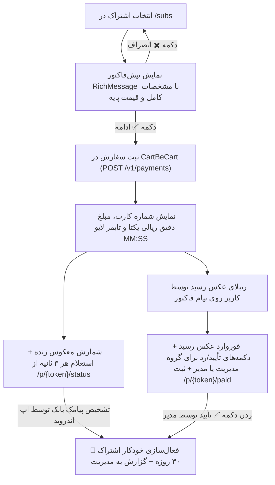

# 🤖 Rasta AI Telegram Bot | چت بات هوشمند تلگرام «رستا»

**دستیار هوش مصنوعی چندمدله تلگرام با استریمینگ زنده، حالت روح (Inline)، پردازش ویس و تصویر، ابزارهای لحظه‌ای بازار ایران و سیستم پرداخت خودکار کارت‌به‌کارت**

*A Next-Generation Multi-Model Telegram AI Assistant with Live Rich Streaming, Inline Ghost Mode, Voice & Vision, Real-Time Iran Market Tools, and Automated SMS Card-to-Card Payments*

[**🇮🇷 مستندات فارسی**](#-مستندات-فارسی) • [**🇬🇧 English Documentation**](#-english-documentation)

---

# 🇮🇷 مستندات فارسی

## ✨ معرفی پروژه
**رستا (Rasta)** یک ربات تلگرامی پیشرفته و دوزبانه (فارسی/انگلیسی) است که روی `aiogram 3.31` و ساختار کاملاً ناهمگام (`asyncio`) طراحی شده است. رستا از سه موتور هوش مصنوعی مجزا، استریمینگ زنده پیام‌ها با شمارنده ثانیه فکر کردن (`Thinking Timer`)، حالت روح (`Ghost Mode`) در تمام چت‌های تلگرام، تشخیص صدا و تصویر، دانلود موزیک، نرخ لحظه‌ای طلا/دلار و سیستم اشتراک با درگاه **کارت‌به‌کارت خودکار پیامکی (`pay.pycourse.ir`) + تأیید دستی رسید** بهره می‌برد.

---

## 🧠 معماری مدل‌های هوش مصنوعی

رستا از ۳ مدل مکمل پشتیبانی می‌کند که کاربر از منوی `/model` می‌تواند بین آن‌ها جابه‌جا شود:

| مدل | شناسه پیش‌فرض | ارائه‌دهنده | ویژگی‌ها و کاربرد | دسترسی |
| :--- | :--- | :--- | :--- | :--- |
| **🔮 Gemini 3.8 Flash** | `gemini` | `Gemini` | مدل اصلی همه‌فن‌حریف، پشتیبانی از بینایی ماشین (تصویر)، ویس، ابزارهای زنده (قیمت طلا/دلار، دیجی‌کالا، جستجوی وب، تقویم جلالی) | همه کاربران (با سهمیه روزانه) |
| **🧠 Claude Sonnet 5.5** | `claude-sonnet-5-5` | `Claude` | مدل قدرتمند استدلال، کدنویسی حرفه‌ای، تحلیل عمیق و پاسخ‌های دقیق. نسخه آنتی گرویتی(ag)  | ویژه اشتراک‌های **فلاور، گلد، رستا و هدیه** 🔒 |
| **⚡ PyCourse Lite** | `pyc-lite` | `pycourse.ir` | مدل سریع و کم‌مصرف با سیستم‌پرامپت فوق‌فشرده و تاریخچه بهینه (۱ پیام اخیر)؛ جایگزین خودکار هنگام اتمام سهمیه روزانه | همه کاربران (سهمیه هفتگی) |

---

## 🔥 قابلیت‌های کلیدی

### ۱. استریمینگ زنده و رابط کاربری RichMessage
- **استریم زنده (`draft` / `edit` / `inline`):** پشتیبانی از متد جدید `sendRichMessageDraft` تلگرام همراه با عقب‌گرد خودکار (Fallback) به ویرایش زنده پیام.
- **ثانیه‌شمار زنده تفکر (`Thinking Timer`):** نمایش زمان دقیق پردازش مدل به‌صورت زنده پیش از شروع استریم متن.
- **قالب‌بندی هوشمند RTL و نقل‌قول کشویی:** تیتر اول پاسخ به شکل بولد و ادامه متن درون باکس نقل‌قول قابل‌بازشدن (`expandable_blockquote`) با رعایت جهت راست‌به‌چپ فارسی.

### ۲. حالت روح (`Ghost Mode` — Inline Query)
- با تایپ `@bot_username متن سوال` در **هر چت شخصی، گروه یا کانال**، بدون نیاز به حضور مستقیم ربات در آن چت، پاسخ هوش مصنوعی درجا استریم و تکمیل می‌شود.

### ۳. چندرسانه‌ای: ویس، تصویر و موزیک‌یاب
- **تبدیل ویس به متن (`Speech-to-Text`):** ارسال ویس فارسی یا انگلیسی، تبدیل خودکار به متن با `SpeechRecognition` و `ffmpeg` و پاسخ‌گویی مستقیم توسط هوش مصنوعی.
- **بینایی ماشین (`Vision`):** ارسال عکس یا ریپلای روی عکس برای تحلیل، استخراج متن (OCR) یا حل مسئله.
- **موزیک‌یاب هوشمند (`Music Finder`):** جستجو و ارسال مستقیم فایل صوتی آهنگ‌ها از طریق `yt-dlp` با دستور یا درخواست متنی.

### ۴. ابزارهای زنده بازار ایران و وب (Function Calling & MCP)
- **💵 نرخ لحظه‌ای دلار و ارز (`/dollar`):** دریافت آنلاین نرخ دلار، یورو، درهم و تتر از `tgju-mcp`.
- **🪙 نرخ طلا و سکه (`/gold`):** دریافت لحظه‌ای مظنه طلا ۱۸ عیار، سکه امامی، بهار آزادی، نیم و ربع سکه.
- **🛒 جستجوی قیمت دیجی‌کالا (`digikala_price`):** استعلام قیمت و مشخصات کالاها از دیجی‌کالا.
- **📰 اخبار ایران و جستجوی زنده وب (`live_search`):** دسترسی به آخرین اخبار ایران (`iran-news-mcp`) و موتور جستجوی DuckDuckGo.

### ۵. گاردریل‌های امنیتی چندلایه و معنایی (Semantic Embedding Guard)
- **محافظت در برابر افشای پرامپت (`leak_guard`):** ترکیب فیلترهای عبارات باقاعده و مدل امبدینگ `text-embedding-3-small` پای‌کورس برای تشخیص معنایی حملات Prompt Injection.
- **محافظت از توکن بات و تخلیه توکن (`no_bot_token` / `no_token_drain`):** مسدودسازی ارسال توکن‌های تلگرام و جلوگیری از درخواست‌های اسپم یا استخراج انبوه توکن.
- **قفل کدنویسی برای پلن رایگان و برنز:** جلوگیری از تولید کدهای برنامه‌نویسی در پلن رایگان/برنز و هدایت کاربر به اشتراک فلاور و بالاتر.

---

## 💎 جدول اشتراک‌ها و سهمیه‌ها (`/subs`)

سهمیه مدل‌های Gemini و Claude بر پایه **واحدهای ۱۵۰ توکنی** در روز (بازنشانی در ساعت `00:00` به وقت تهران) و سهمیه `pyc-lite` به‌صورت هفتگی محاسبه می‌شود:

| پلن اشتراک | سهمیه روزانه Gemini | سهمیه روزانه Claude 5.5 | ویس روزانه | کدنویسی | ظرفیت هفتگی `pyc-lite` | قیمت (۳۰ روزه) |
| :--- | :---: | :---: | :---: | :---: | :---: | :---: |
| **🌱 عادی (رایگان)** | ۲۰ پیام (۳,۰۰۰ توکن) | 🔒 قفل | ۵ ویس | ❌ قفل | `1x/هفته` (۱,۰۰۰ توکن) | رایگان |
| **🥉 برنز (`bronze`)** | ۶۰ پیام (۹,۰۰۰ توکن) | 🔒 قفل | ۱۰ ویس | ❌ قفل | `1.75x/هفته` (۱,۷۵۰ توکن) | ۷۵,۰۰۰ تومان |
| **🌸 فلاور (`flower`)** | ۱۰۰ پیام (۱۵,۰۰۰ توکن) | **۵۰ پیام** (۷,۵۰۰ توکن) | ۲۰ ویس | ✅ باز | `2.25x/هفته` (۲,۲۵۰ توکن) | ۱۱۰,۰۰۰ تومان |
| **🥇 گلد (`gold`)** | ۱۷۰ پیام (۲۵,۵۰۰ توکن) | **۹۵ پیام** (۱۴,۲۵۰ توکن) | ۳۵ ویس | ✅ باز | `2.75x/هفته` (۲,۷۵۰ توکن) | ۱۸۰,۰۰۰ تومان |
| **👑 رستا (`rasta`)** | ۵۰۰ پیام (۷۵,۰۰۰ توکن) | **۳۰۰ پیام** (۴۵,۰۰۰ توکن) | ۱۰۰ ویس | ✅ باز | `5x/هفته` (۵,۰۰۰ توکن) | ۳۵۱,۰۰۰ تومان |
| **🎁 هدیه (`gift`)** | ۵۵ پیام (۸,۲۵۰ توکن) | **۳۰ پیام** (۴,۵۰۰ توکن) | ۱۲ ویس | ✅ باز | `1.75x/هفته` (۱,۷۵۰ توکن) | ۵ دعوت با خرید موفق |

---

## 💳 سیستم پرداخت دوگانه کارت‌به‌کارت (خودکار پیامکی + رسید تصویری)

فرآیند خرید اشتراک در رستا به‌گونه‌ای طراحی شده که هم **تأیید خودکار آنی** دارد و هم **پشتیبان دستی برای مدیر**:

1. **پیش‌فاکتور قبل از پرداخت:** با کلیک روی هر پلن، ابتدا مشخصات کامل آن پلن و قیمت پایه همراه با دو دکمه ریچ‌مسیجی **ادامه** و **انصراف** نمایش داده می‌شود.
2. **مبلغ دقیق یکتا و تایمر لایو:** پس از تأیید ادامه، سفارش در سرویس `https://pay.pycourse.ir` ثبت شده و مبلغ دقیق ریالی (قیمت پایه + ۱ تا ۹۹۹۹ ریال رقم یکتا برای تطبیق پیامک بانکی) به همراه دکمه کپی شماره کارت، دکمه کپی مبلغ دقیق و **تایمر لایو شمارش معکوس (`⏳ MM:SS`)** نمایش داده می‌شود.
3. **تأیید خودکار پیامکی:** به‌محض واریز مبلغ دقیق ریالی، اپلیکیشن اندروید متصل به `pay.pycourse.ir` پیامک بانک را تشخیص داده و ربات بدون دخالت دست، اشتراک کاربر را فعال می‌کند.
4. **حفظ ارسال رسید برای مدیر / گروه مدیریت:** همزمان کاربر می‌تواند تصویر رسید را روی پیام فاکتور ریپلای کند تا عکس رسید به همراه دکمه‌های **✅ تأیید اشتراک** و **❌ رد رسید** به گروه مدیریت (یا پی‌وی مدیر) ارسال شود.

---

## ⌨️ دستورات ربات

### دستورات عمومی کاربران
| دستور | توضیح |
| :--- | :--- |
| `/start` | منوی اصلی، معرفی قابلیت‌ها و ثبت لینک دعوت (`referral`) |
| `/model` | مشاهده و تغییر مدل فعال (`Gemini 3.8`، `Claude Sonnet 5.5`، `pyc-lite`) |
| `/subs` | جدول اشتراک‌های ویژه، لینک دعوت اختصاصی و خرید اشتراک |
| `/usage` یا `/quota` | مشاهده دقیق میزان مصرف توکن، ویس و زمان بازنشانی سهمیه‌ها |
| `/dollar` | تابلوی لحظه‌ای نرخ دلار، یورو، درهم و تتر |
| `/gold` | تابلوی لحظه‌ای نرخ طلا ۱۸ عیار و انواع سکه |
| `/lang` | تغییر زبان رابط کاربری ربات (فارسی 🇮🇷 / انگلیسی 🇬🇧) |
| `/feedback` | ارسال انتقاد، پیشنهاد یا گزارش باگ به گروه مدیریت (روزی ۱ بار) |
| `/reset` | پاک‌سازی تاریخچه گفتگوی فعلی با هوش مصنوعی |
| `/help` | راهنمای کامل استفاده از ربات |

---
---

# 🇬🇧 English Documentation

## ✨ Overview
**Rasta** is a production-grade, bilingual (Persian/English) AI Telegram bot built with Python `asyncio` and `aiogram 3.31`. It orchestrates three LLM backends (**Gemini 3.8 Flash**, **Claude Sonnet 5.5**, and **PyCourse Lite `pyc-lite`**), delivers real-time streaming responses with a live thinking timer, works in any chat via **Inline Ghost Mode**, processes voice notes and images, fetches live Iranian market data (USD/Gold/Digikala), and features a hybrid **Automated SMS Card-to-Card Payment System (`pay.pycourse.ir`) + Manual Receipt Verification**.

---

## 🧠 Multi-Model LLM Architecture

Users can switch models on the fly via `/model`:

1. **🔮 Gemini 3.8 Flash (`Gemini Google AI Studio`):** Default multimodal powerhouse supporting images, voice transcription, and live tool calling (Iran currency/gold market, Digikala product lookup, web search, Jalali calendar).
2. **🧠 Claude Sonnet 5.5 (`ag/claude-sonnet-5-5`):** Dedicated API configuration (`CLAUDE_API_KEY`) for advanced reasoning and coding. Locked for Free/Bronze users and unlocked exclusively for **Flower, Gold, Rasta, and Gift** subscribers.
3. **⚡ PyCourse Lite (`pyc-lite` via `pycourse.ir`):** Ultra-fast model with a minimal token-saving system prompt and 1-message history window (`history[-1:]`), serving both as a selectable lightweight model and an automatic fallback when daily quotas are exhausted.

---

## 🔥 Key Features

- **Live Rich Streaming & Thinking Timer:** Uses Telegram's `sendRichMessageDraft` (with seamless fallback to message editing) and displays a live second-by-second thinking counter before tokens arrive.
- **Inline Ghost Mode (`@bot_username <prompt>`):** Invoke Rasta inside any private chat or group without adding the bot to the chat, complete with live inline message streaming.
- **Voice, Vision & Music Finder:**
  - Transcribes Persian and English voice messages via `SpeechRecognition` + `ffmpeg`.
  - Analyzes photos and screenshots with multimodal vision.
  - Downloads and sends audio tracks on demand using `yt-dlp`.
- **Real-Time Iran Market & Web Tools:** Built-in `/dollar` and `/gold` dashboards powered by `tgju-mcp`, product search via `digikala-mcp`, news via `iran-news-mcp`, and live web search via `duckduckgo-search`.
- **Multi-Layer Security & Semantic Guardrails:** Combines fast regex filters with semantic cosine similarity (`text-embedding-3-small`) to block prompt-leak attempts, bot token exposure, spam, and unauthorized code generation on free plans.

---

## 💎 Subscription Plans & Quotas

Daily quotas for Gemini and Claude are measured in **150-token message units** (resetting at `00:00` Asia/Tehran), while `pyc-lite` uses a weekly token pool:

| Plan | Daily Gemini | Daily Claude 5.5 | Daily Voice | Coding | Weekly `pyc-lite` | Price (30 Days) |
| :--- | :---: | :---: | :---: | :---: | :---: | :---: |
| **🌱 Free** | 20 msgs (3,000 tok) | 🔒 Locked | 5 | ❌ Locked | `1x/week` | Free |
| **🥉 Bronze** | 60 msgs (9,000 tok) | 🔒 Locked | 10 | ❌ Locked | `1.75x/week` | 75,000 Toman |
| **🌸 Flower** | 100 msgs (15,000 tok) | **50 msgs** (7,500 tok) | 20 | ✅ Unlocked | `2.25x/week` | 110,000 Toman |
| **🥇 Gold** | 170 msgs (25,500 tok) | **95 msgs** (14,250 tok) | 35 | ✅ Unlocked | `2.75x/week` | 180,000 Toman |
| **👑 Rasta** | 500 msgs (75,000 tok) | **300 msgs** (45,000 tok) | 100 | ✅ Unlocked | `5x/week` | 351,000 Toman |
| **🎁 Gift** | 55 msgs (8,250 tok) | **30 msgs** (4,500 tok) | 12 | ✅ Unlocked | `1.75x/week` | 5 Paid Referrals |

---

## 💳 Hybrid Card-to-Card Payment System (`pay.pycourse.ir`)

1. **Step 1 — Pre-Invoice Preview:** Clicking a plan in `/subs` displays a RichMessage pre-invoice with full plan specifications, base price, and **Continue** (`confirm_buy:<plan>`) / **Cancel** (`cmd:subs`) buttons.
2. **Step 2 — Unique Rial Amount & Live Countdown Timer:** Clicking Continue creates a payment on **CartBeCart (`POST /v1/payments`)** and fetches destination card details and `seconds_left` from `GET /p/{token}/status`. The bot renders the exact unique `amount_rial` (base amount + 1..9999 Rial suffix), one-tap copy buttons for both the card number and exact Rial amount, and a **live ticking countdown timer (`⏳ MM:SS`)**.
3. **Step 3 — Automatic SMS Matching + Manual Receipt Backup:**
   - **Auto SMS Confirmation:** A background watcher polls `/p/{token}/status` every 3 seconds. As soon as the merchant's Android SMS app matches the incoming bank SMS with the exact `amount_rial`, the bot automatically activates the 30-day subscription and logs the approval to the Management Group.
   - **Manual Photo Receipt Forwarding:** Users are also instructed to reply to the invoice message with a photo of their payment receipt. Replying with a photo forwards the receipt + `✅ Approve` / `❌ Reject` buttons to the Management Group (or Owner PV) and notifies `POST /p/{token}/paid`.

---
Rasta isn't a open source project. maybe soon.
Created By mfvictor | mfvictor.ir
